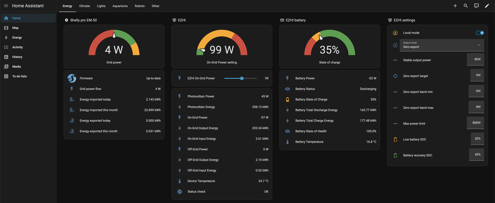

# EZHI zero export for Home Assistant



Home Assistant automations that keep an **APsystems EZHI** hybrid microinverter, running in **Local mode**, at (almost) zero grid export, using a grid meter such as a **Shelly Pro EM-50**. They also protect the battery by dropping to a fixed output when the state of charge is low, warn you if a sensor goes offline, and start a top-up charge when the battery has not been full for a while.

> Use at your own risk. Test carefully and check the rules for balcony/plug-in PV in your country. This is a hobby project, not electrical or legal advice.

## My setup

| Part | Model |
|---|---|
| Inverter | APsystems EZHI |
| Grid meter | Shelly Pro EM-50 (LAN connection) |
| Battery | EPEVER LFP2.71KWH51.2V-P65H1 ([manual](https://solarv.de/Datenblatt/2025/09/epever/LFP2.71KWH51.2V-P65H1-Manual-EN-V1.0.pdf)) |
| Panels | 2x Luxor 460W Mono N-Type TOPCon Glass-Glass Bifacial (LX-460M/182R-96+GG) |
| Home Assistant integration | [kamilkosek/EZHI](https://github.com/kamilkosek/EZHI) |

## How it works

The grid meter reports power in watts: **positive = importing, negative = exporting**.

In **Zero export** mode, every time the meter value changes the automation calculates:

```
new limit = current limit + grid power - target
```

clamped between 30 W and the maximum power limit. The target (4 W by default), the margin (0 to 8 W by default) and the maximum power limit (30 to 1200 W) are adjustable values. It only acts when grid power is outside the margin, and waits for a 3 second cooldown after each write.

The mode is selected with a dropdown helper:

| Mode | Behavior |
|---|---|
| `Zero export` | The control loop keeps grid import at about the target (4 W by default) |
| `Stable output (auto)` | The inverter is held at a fixed limit (the stable output power, 40 W by default). Set by the automations on low battery or connectivity problems, and switched back to Zero export when the battery has recovered or the sensors have been stable again |
| `Stable output (permanent)` | Same fixed limit, but chosen by you: no automation changes the mode until you do |
| `No output` | The power limit is set to 0 W and re-applied every minute. Set when local mode is switched off or a top-up starts, or chosen by you: no automation switches out of it, except the top-up finish at the end of a top-up |

## Requirements

- EZHI set to **Local mode**
- Home Assistant with the [EZHI integration](https://github.com/kamilkosek/EZHI) (or any other way to set the EZHI on-grid power limit as a `number` entity)
- A grid meter exposing signed power in W (positive = import)
- A battery state of charge sensor in %
- The helpers below, including the number helpers for the adjustable values
- Optional: the Home Assistant companion app for phone notifications

## Helpers

| Helper | Purpose |
|---|---|
| [`input_select.ezhi_output_mode`](helpers/ezhi-output-mode.md) | Output mode selector: `Zero export` / `Stable output (auto)` / `Stable output (permanent)` / `No output` |
| [`timer.ezhi_cooldown`](helpers/ezhi-cooldown.md) | Short pause between inverter writes (3 seconds) |
| [`input_boolean.ezhi_local_mode`](helpers/ezhi-local-mode.md) | Master switch: the automations run only while it is on. Turning it off sets No output and hands the EZHI back to the cloud |
| [Number helpers](helpers/ezhi-adjustable-values.md) | Eight adjustable values: zero export target and margin, maximum power limit, stable output power, low battery and recovery levels, top-up interval |
| [Top-up helpers](helpers/ezhi-top-up.md) | `input_datetime.ezhi_last_full_charge` (date of the last full charge) and `input_boolean.ezhi_top_up` (a top-up is in progress) |

## Automations

| File | What it does |
|---|---|
| [`zero-export.yaml`](automations/zero-export.yaml) | The control loop: adjusts the power limit to keep grid import at about the target |
| [`max-power-limit-clamp.yaml`](automations/max-power-limit-clamp.yaml) | Lowers the power limit straight away when you lower the maximum power limit |
| [`stable-output-on-selection.yaml`](automations/stable-output-on-selection.yaml) | Sets the stable output power when either Stable output option is selected |
| [`stable-output-timed-check.yaml`](automations/stable-output-timed-check.yaml) | Re-applies the fixed limit every minute while in either Stable output mode |
| [`no-output-on-selection.yaml`](automations/no-output-on-selection.yaml) | Sets the power limit to 0 W when No output is selected |
| [`no-output-timed-check.yaml`](automations/no-output-timed-check.yaml) | Re-applies the 0 W limit every minute while in No output |
| [`local-mode-off-no-output.yaml`](automations/local-mode-off-no-output.yaml) | When local mode is switched off, sets the mode to No output and the limit to 0 W |
| [`low-battery-mode.yaml`](automations/low-battery-mode.yaml) | Switches from Zero export to Stable output (auto) when SoC reaches the low battery level (35 % by default) or lower, and checks again when local mode is switched on |
| [`battery-recovered.yaml`](automations/battery-recovered.yaml) | Switches from Stable output (auto) back to Zero export when SoC reaches the recovery level (45 % by default). Does nothing in the other modes |
| [`connectivity-problem.yaml`](automations/connectivity-problem.yaml) | Notifies you if a sensor goes unavailable, and switches from Zero export to Stable output (auto) |
| [`connectivity-recovery.yaml`](automations/connectivity-recovery.yaml) | Switches from Stable output (auto) back to Zero export once the SoC sensor and grid meter have been valid for 3 minutes and SoC is at the recovery level or more, and notifies you. Does nothing in the other modes |
| [`top-up-record-full-charge.yaml`](automations/top-up-record-full-charge.yaml) | Remembers when the battery last showed 100 % |
| [`top-up-start.yaml`](automations/top-up-start.yaml) | At 09:00, if there was no full charge for the top-up interval, starts a top-up: sets No output and turns the top-up toggle on |
| [`top-up-finish.yaml`](automations/top-up-finish.yaml) | When the battery has stayed at 100 % for a minute during a top-up, switches back to Zero export and notifies you |
| [`top-up-cancel.yaml`](automations/top-up-cancel.yaml) | Cancels a top-up when you change the mode yourself or switch local mode off |
| [`top-up-toggled-on-set-no-output.yaml`](automations/top-up-toggled-on-set-no-output.yaml) | Turning the top-up toggle on by hand sets No output |

## Setup

1. Create the [helpers](#helpers), then set the value of every number helper (a new number helper starts at its minimum, see [how to set them](helpers/ezhi-adjustable-values.md#set-the-values-after-creating-the-helpers)).
2. For each automation file, replace every placeholder written in capital letters (see the table below). Placeholders are in the form `sensor.YOUR_...`, `number.YOUR_...` and `notify.mobile_app_YOUR_PHONE`.
3. Create the automations in Home Assistant (Settings > Automations & scenes > Create automation > three dots > Edit in YAML) and paste each file.
4. Start in `Stable output (permanent)`, then switch to `Zero export` once you have checked that the values look right. (In `Stable output (auto)` the recovery automations would switch to Zero export on their own.)

### Placeholders

| Placeholder | Replace with |
|---|---|
| `sensor.YOUR_GRID_POWER_SENSOR` | Grid meter power sensor in W (positive = import, negative = export) |
| `number.YOUR_EZHI_POWER_LIMIT` | Number entity that sets the EZHI on-grid power limit |
| `sensor.YOUR_EZHI_BATTERY_SOC_SENSOR` | Battery state of charge sensor in % |
| `notify.mobile_app_YOUR_PHONE` | Notify service of your phone |

## Weekly top-up charge

In winter the battery can go many days without reaching 100 %. The BMS state of charge estimate then drifts, and the battery can suddenly drop to 0 % and lock up. The EZHI has no function to force a full charge or to charge from the grid, so these automations fill the battery from solar by keeping the house off it for a while:

- [`top-up-record-full-charge.yaml`](automations/top-up-record-full-charge.yaml) remembers when the SoC last showed 100 %.
- [`top-up-start.yaml`](automations/top-up-start.yaml) runs at 09:00. If the last full charge is older than the top-up interval (adjustable, for example 3 days) and the mode is `Zero export` or `Stable output (auto)`, it turns the top-up toggle on and sets `No output`. All PV then goes into the battery and the house runs on the grid. It stays in `No output`, also overnight, until the battery is full. In winter a full charge from a low state can take two or more sunny days.
- [`top-up-finish.yaml`](automations/top-up-finish.yaml) switches back to `Zero export` and notifies you when the SoC has stayed at 100 % for one minute.
- [`top-up-cancel.yaml`](automations/top-up-cancel.yaml) cancels a top-up if you change the mode yourself or switch local mode off.
- [`top-up-toggled-on-set-no-output.yaml`](automations/top-up-toggled-on-set-no-output.yaml) sets `No output` when you turn the top-up toggle on by hand, so one switch starts a top-up.

`Stable output (permanent)` and a `No output` that you chose yourself are respected by the automatic start. The top-up finishes when the SoC is above 99 %, so if your sensor never shows 100 %, lower that threshold in the record and finish automations. See [`ezhi-top-up.md`](helpers/ezhi-top-up.md) for the helpers and for starting or ending a top-up by hand.

## Battery limits in the AP EasyPower app

My settings in the AP EasyPower app at the moment of writing:

| Setting | Value | Effect |
|---|---|---|
| Min SOC | 25 % | The inverter stops on-grid output when the SoC reaches 25 % |
| Recovery SOC | 35 % | The inverter starts on-grid output again when the SoC reaches 35 % |

My Home Assistant levels are the low battery level (35 %) and the recovery level (45 %). How it all fits together:

- **Home Assistant acts first.** The low battery automation triggers when the SoC reaches 35 %, 10 points above the level where the inverter stops. The system then drops to the fixed 40 W output and the battery drifts down slowly: 10 % of a 2.71 kWh battery is roughly 270 Wh, about 7 hours at 40 W, which is roughly one night.
- **It protects the zero export loop.** The loop works from the limit it last wrote. If the inverter stopped on-grid output at 25 % while the loop was still running, grid import would rise and the loop would keep raising the limit towards the maximum without the real output following. Switching to Stable output writes the fixed limit again, which resets that.
- **Between 25 % and 45 %.** After a low battery switch, the mode stays `Stable output (auto)` while the battery charges. If the inverter has stopped at 25 %, it starts again at 35 % and runs at the fixed output (40 W). The battery recovered automation then returns to `Zero export` at 45 %.
- **The margin is wide enough for the sensor delay.** 10 % is roughly 270 Wh, about 20 minutes at 800 W, so the SoC sensor's update interval (about 3 minutes on my setup) is not a problem. With a narrow margin, the inverter could reach its stop level before the automation reacts under heavy load. The app settings are the real safety net, and the automations are a softer first step.
- **If you change the app values,** adjust the low battery and recovery levels in the [number helpers](helpers/ezhi-adjustable-values.md): keep the low battery level above the stop level, and the recovery level above the low battery level.

## Things to know

- **Adjustable values.** The zero export target and margin, the maximum power limit, the stable output power and the battery levels are number helpers, so you can change them from the dashboard without editing the automations (see [`ezhi-adjustable-values.md`](helpers/ezhi-adjustable-values.md)). The values in this repo are mine, set where I want them for now. The 30 W minimum power limit is fixed in `zero-export.yaml`.
- **Setpoint based.** The control loop works from the limit it last wrote, not from the inverter's measured output, because the inverter output sensor on my setup only updates every few minutes. If your sensor updates quickly, using the real output can be more accurate.
- **Battery thresholds.** Keep a gap between the low and recovered values if the SoC tends to hover around them, otherwise the mode can flip back and forth.
- **Maximum power limit.** The maximum limit the zero export loop may set is the number helper `input_number.ezhi_max_power_limit` (30 to 1200 W). Check that your power limit entity's `max` allows it and that your hardware is rated for it. If the inverter cannot deliver the full limit, the loop can overshoot, because it works from the limit it last wrote and not from the measured output.
- **Local mode switch.** Switching `input_boolean.ezhi_local_mode` off sets the mode to `No output` and the limit to 0 W once. After that no automation runs: no inverter writes, no mode changes and no notifications. In cloud mode, writes to the power limit succeed but do not change the real output. After you switch it on again, the mode stays `No output` until you select one. See [`ezhi-local-mode.md`](helpers/ezhi-local-mode.md).
- **Your choice is respected.** Select `Stable output (permanent)` or `No output` and the low battery, battery recovered, connectivity problem, connectivity recovery and top-up start automations leave the mode alone (the connectivity problem automation still notifies you).
- **No delay on connectivity problems.** Even a one-second unavailable moment of the grid meter or the SoC sensor switches to `Stable output (auto)` and sends a notification. This is intentional.
- **Automatic recovery.** Once both sensors have been valid for 3 minutes and the battery is at 45 % or more, `connectivity-recovery.yaml` switches back to `Zero export` and notifies you. Use `Stable output (permanent)` if you want to decide yourself.

## Contributing

Issues and pull requests are welcome.
